# peakst8 product notes

Public product notes for peakst8 features. Site: [peakst8-basecamp.github.io/product-notes](https://peakst8-basecamp.github.io/product-notes/)

| Note | Status | Links |
| --- | --- | --- |
| **peakst8 Embed** | Scoped, pilot from 30 Nov 2026 | [Note](https://peakst8-basecamp.github.io/product-notes/embed/) · [Prototype](https://peakst8-basecamp.github.io/product-notes/embed/prototype/) · [Folder](embed/) |

---

# peakst8 Embed

**A peakst8 product feature.** peakst8 Embed lets a club sell its events on its own website. Event pages rank on Google and get cited by AI answer engines on the club's domain. peakst8 still runs checkout, payments, refunds and check-in, so the GMV take is unchanged.

[Product note](https://peakst8-basecamp.github.io/product-notes/embed/) · [Clickable prototype](https://peakst8-basecamp.github.io/product-notes/embed/prototype/) · Internal · updated 28 Oct 2026

## Who we're building it for

**ICP:** community fitness organisers and event runners in Indian metros who run paid events, have a website they want to grow, and no in-house developer. Today they list on peakst8 and link out, so the search traffic never builds up on their own domain.

The pilot starts with three organisers:

| Pilot | What they run | What Embed gives them | Go-live (proposed) |
| --- | --- | --- | --- |
| **Find Your Fit** | Recurring community runs and sessions | Every run ranks on their own site; bookings without leaving it | 30 Nov 2026 |
| **Sisters in Sweat** | Women's fitness community events | Their brand all the way through checkout; one place for all their events | 7 Dec 2026 |
| **Cubbon Classic 10K** | A chip-timed 10K race with club entries (Edition 2, 21 Mar 2027) | A race page that ranks and gets quoted for "10K in Bengaluru" searches, plus club codes and bibs in peakst8 | 14 Dec 2026 |

## The problem

- **Traffic leaks.** Linking out to a ticketing page sends every searcher to another domain.
- **Iframe embeds are invisible.** Google credits the vendor, and AI crawlers, which mostly don't run JavaScript, see nothing.
- **No attribution.** Clubs can't fire their GA4 or Meta pixel on a booking.

## Case study: Cubbon Classic 10K today

[cubbonclassic10k.com/register](https://cubbonclassic10k.com/register) is the setup Embed replaces:

| Today | With peakst8 Embed |
| --- | --- |
| Individual entry is a KonfHub widget iframe inside the page | A server-rendered race page on their domain; peakst8 checkout opens on Book |
| Structured data is an Organization and a WebPage only, with no Event markup | Event, FAQ and breadcrumb schema, sitemap and IndexNow |
| Club captain submits a form; the code arrives 24–48 hours later; 10 runners minimum, 7 men + 3 women | Club codes issued on approval (O7); captain tracks the roster against the rule (C2); members join with the code (C3) |
| Chip-timed entry with bibs | Bibs assigned on payment, frozen 7 days before the race, exported as CSV to the timing partner (O7) |

## What we're building

1. **Hosted event pages** on the club's domain (`events.club.in`), server-rendered, with Event and FAQ schema, a sitemap, IndexNow pings, AI crawlers allowed and an `llms.txt`.
2. **A listing block or Book button** for the club's main site, from one snippet.
3. **The same peakst8 checkout** (Choose Pass, Your Details, Waiver & Discounts, email OTP, Razorpay) as a sheet over the club's page, sending booking events to the club's GA4 and pixel.
4. **Race features** for the Cubbon pilot: club-code registration (captain registers, members join with a code, roster rules) and bib numbers with a CSV export to the timing partner. V1 doesn't integrate with timing hardware.

Embed is switched on per organiser from peakst8 admin, so the pilot stays limited to these three.

## Screens

### peakst8 dashboard (organiser)

| O1 · Embeds home | O2 · Choose mode |
| --- | --- |
| 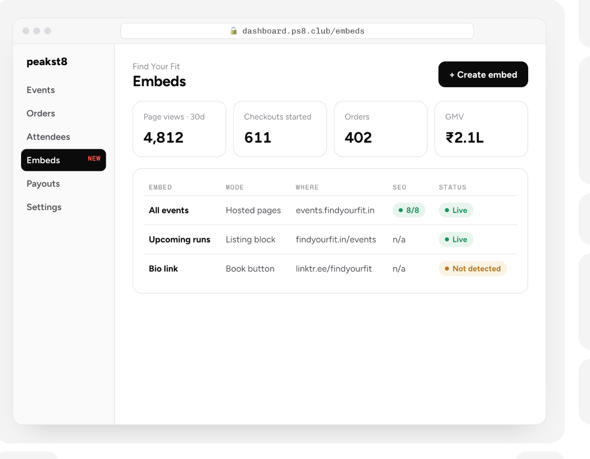 | 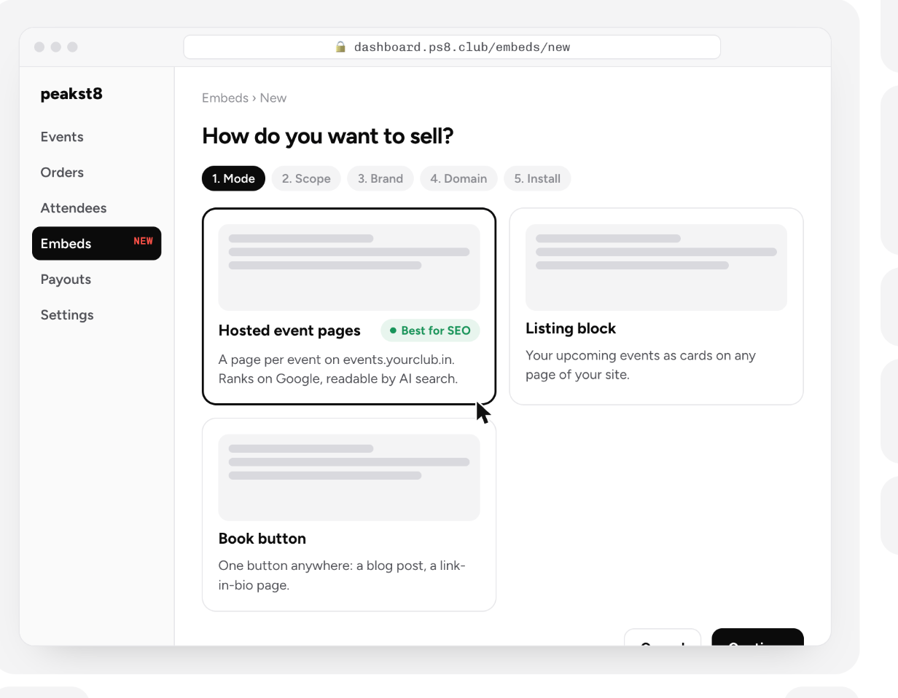 |
| **O3 · Choose scope** | **O4 · Brand** |
| 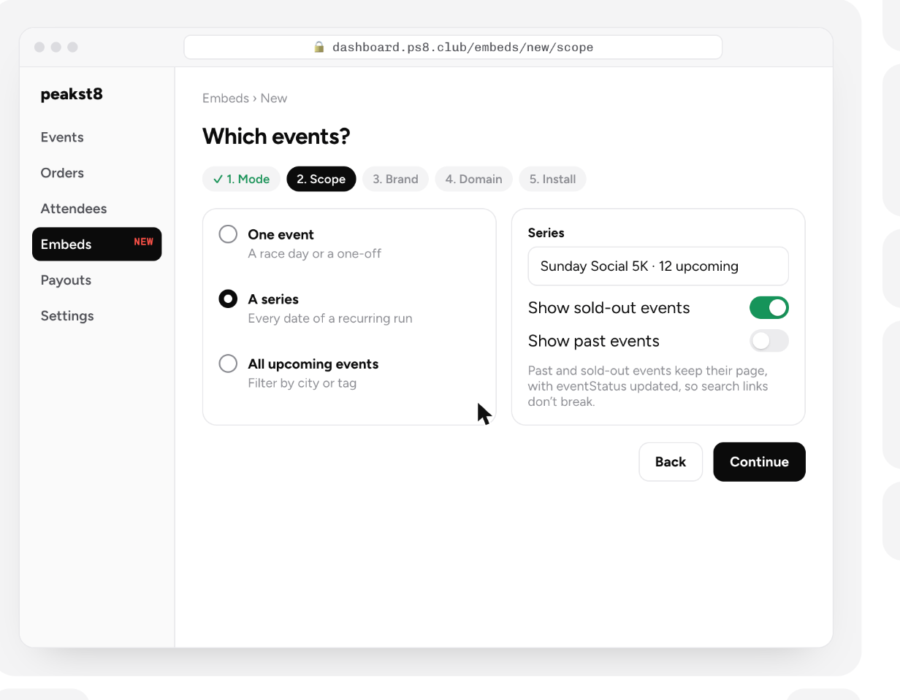 | 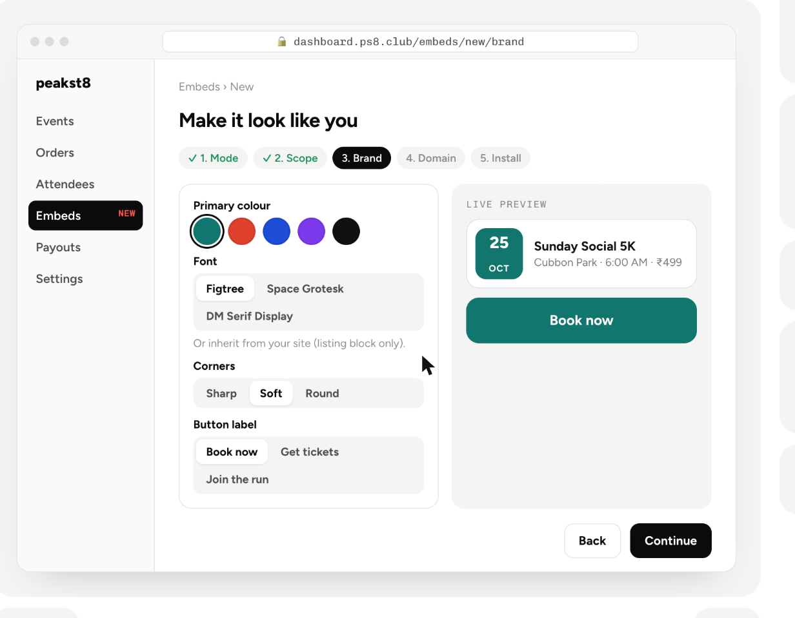 |
| **O5 · Domain and tracking** | **O6 · Install and SEO check** |
| 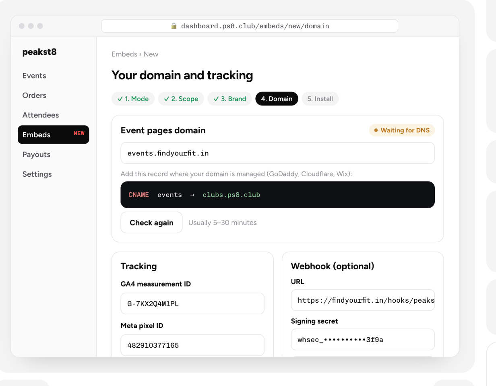 | 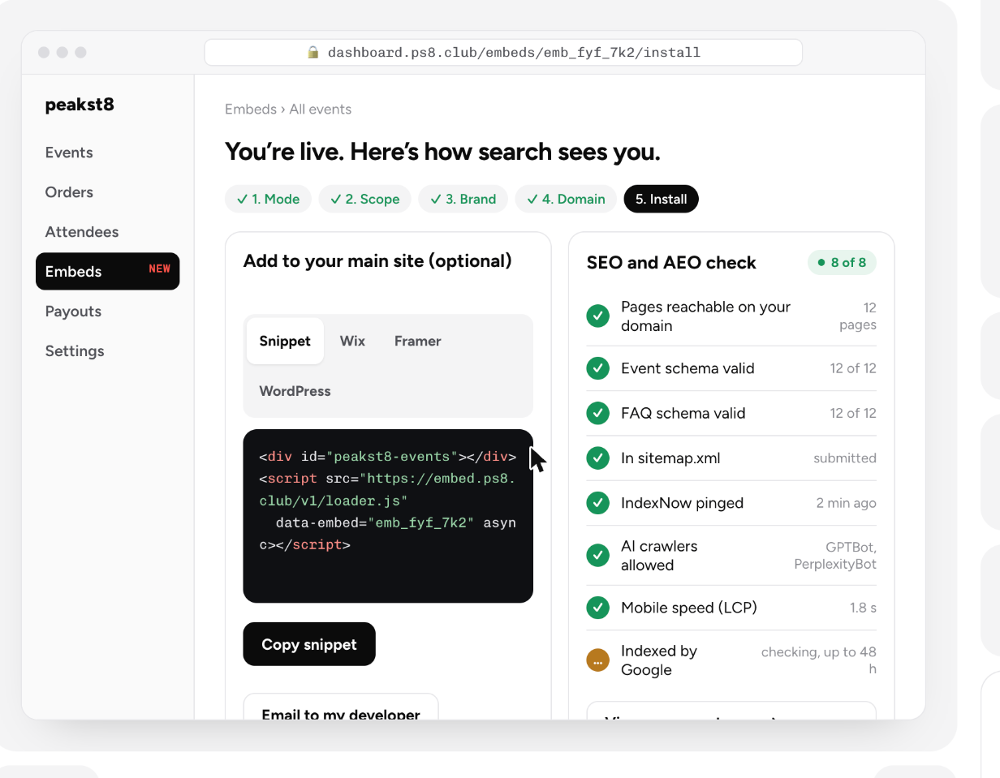 |
| **O7 · Clubs and bibs: club codes** | **O7 · Clubs and bibs: bibs and timing export** |
| 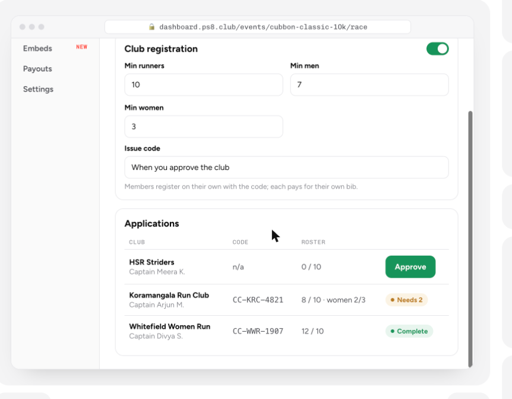 | 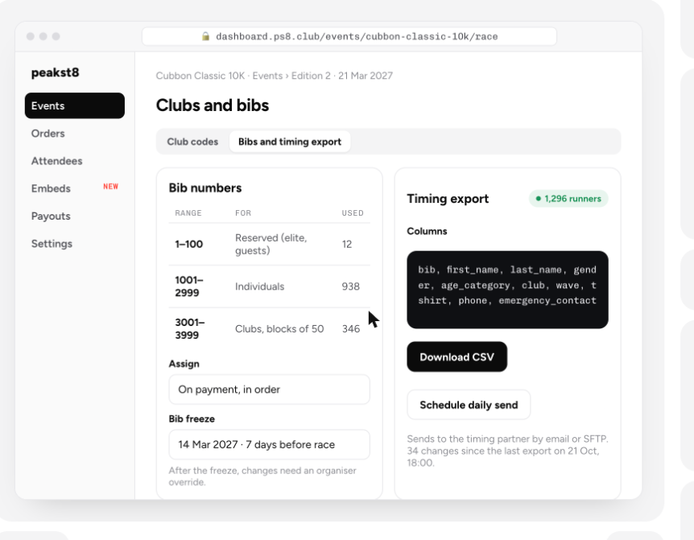 |

### Attendee flow (on the club's site)

The live peakst8 registration flow, re-skinned in the club's brand.

| E1 · Event page | E2 · Choose Pass | E3 · Your Details |
| --- | --- | --- |
| 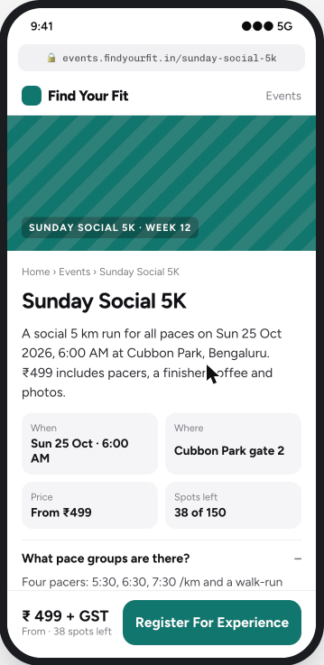 | 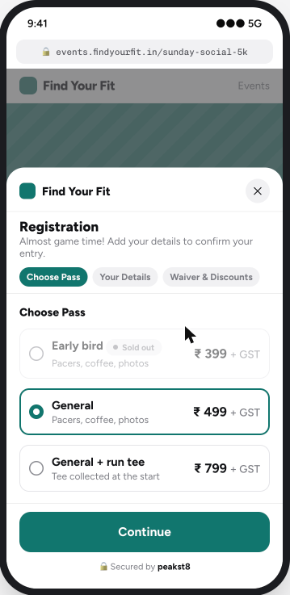 | 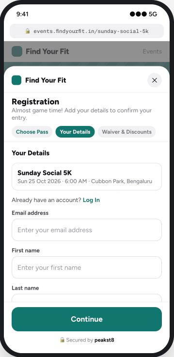 |
| **E4 · Waiver & Discounts** | **E5 · Email OTP** | **E5 · Razorpay** |
| 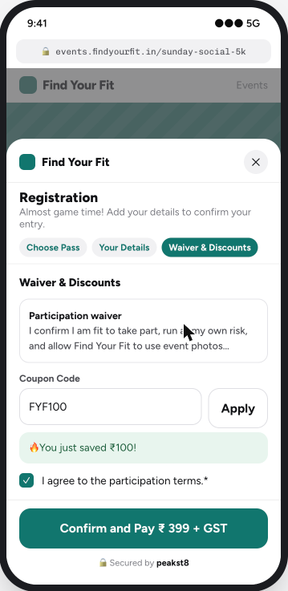 | 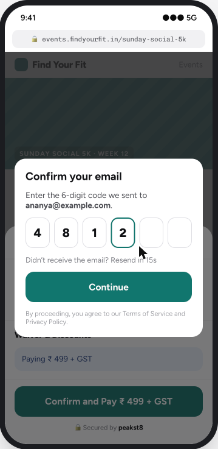 | 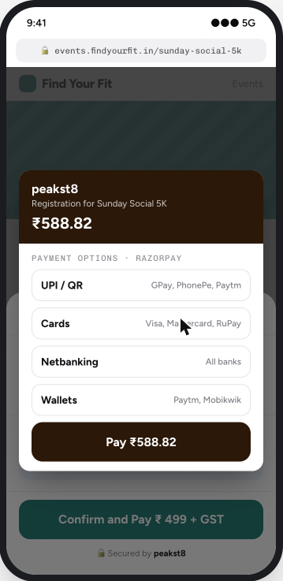 |
| **E6 · Ticket** | | |
| 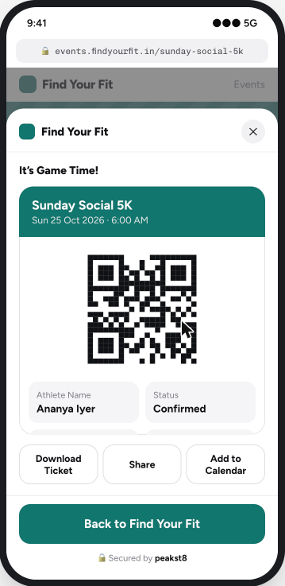 | | |

### Club registration (race site, Cubbon pilot)

| C1 · Captain registers club | C2 · Club code and roster | C3 · Member joins with code | C3 · Ticket with bib |
| --- | --- | --- | --- |
| 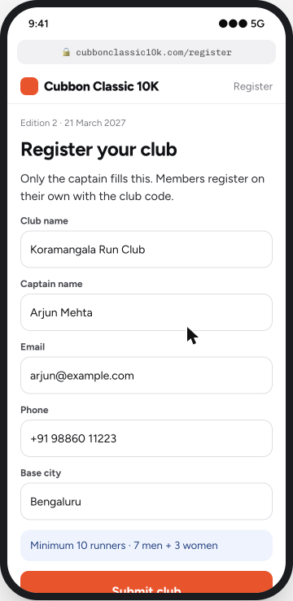 | 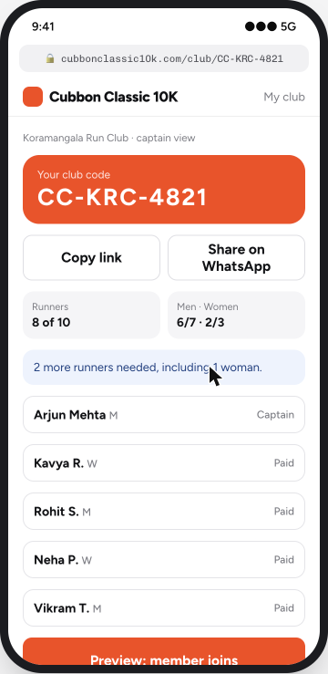 | 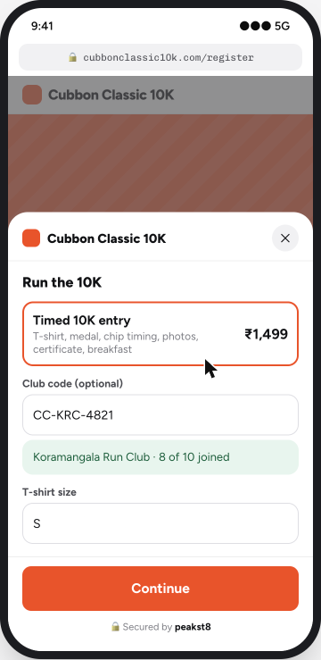 | 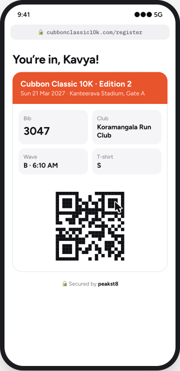 |

### peakst8 admin

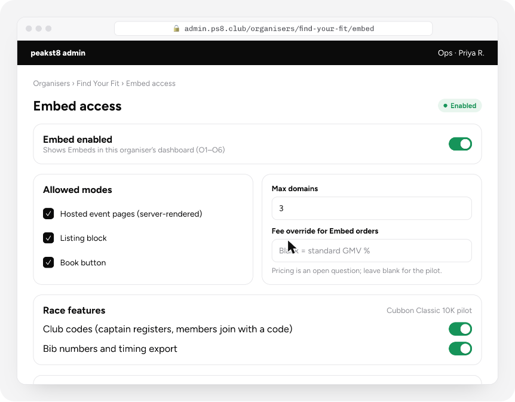

Every state, with acceptance criteria and analytics events, is in the [prototype](https://peakst8-basecamp.github.io/product-notes/embed/prototype/).

## Timeline to go live

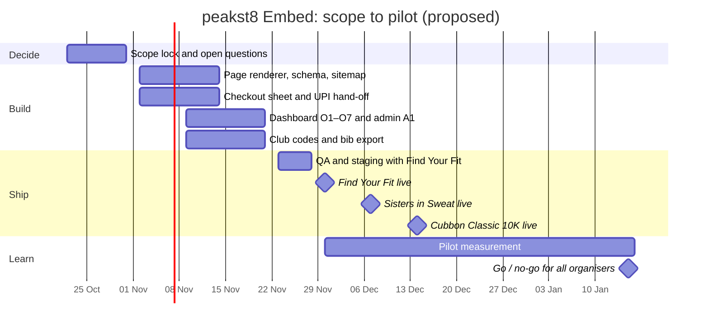

| Gate | Date | Passes when |
| --- | --- | --- |
| Scope lock | 30 Oct | Prototype signed off (checkout matched to the live peakst8 flow on 27 Oct); Razorpay confirms Checkout inside a frame and the mobile UPI hand-off |
| Build complete | 20 Nov | All 17 screens built; SEO check passes 8 of 8 on staging; sample timing export accepted by Cubbon's timing partner |
| First pilot live | 30 Nov | Find Your Fit takes a real order through Embed |
| All pilots live | 14 Dec | All three organisers live with at least one order each; a test club completes C1–C3 |
| Go / no-go | 15 Jan 2027 | Embed share of pilot GMV, mobile Book-to-paid conversion, and organic plus AI-referred bookings reviewed |

## Open questions

- **Canonical:** if the club page is canonical, the peakst8 marketplace listing loses that search traffic.
- **Pricing:** same GMV % on Embed orders, or lower?
- **Data:** can clubs export attendee phone and email?
- **Payments:** does Razorpay allow Checkout inside a frame on the club's domain? This blocks the 30 Oct gate.

## In this repo

| Path | What it is |
| --- | --- |
| `index.html` | Index of product notes |
| `embed/` | peakst8 Embed: note (`index.html`), `prototype/`, `screens/` |
| `robots.txt`, `sitemap.xml`, `llms.txt` | Search and AI crawler files for the site |
